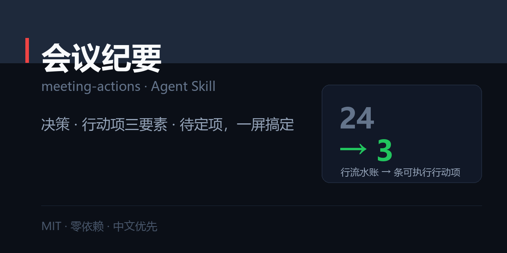

# 会议纪要 · meeting-actions

> 把会议记录变成能执行的纪要：决策、行动项（责任人 + 动词 + 期限）、待定项，一屏，30 分钟内发出。



[](./SKILL.md)
[](./LICENSE)
[](#)

职场五件套之一：[`resume-tailor`](https://github.com/zhbehx/resume-tailor) · [`interview-coach`](https://github.com/zhbehx/interview-coach) · [`weekly-report`](https://github.com/zhbehx/weekly-report) · [`slide-story`](https://github.com/zhbehx/slide-story) · [`meeting-actions`](https://github.com/zhbehx/meeting-actions)

---

## 为什么不是「帮我整理会议记录」

| | 直接让 AI 总结 | 用这个 Skill |
| --- | --- | --- |
| 产出 | 一段"会上讨论了…"的摘要 | 决策 / 行动项 / 待定 三节，一屏 |
| 行动项 | 「跟进小客户问题」 | 张三：输出流失归因表（30 样本），11/3 前 |
| 责任人 | 「产品组」 | 一个真实姓名；无人认领标 `⚠️ 待认领` |
| 期限 | 「尽快」 | 具体日期，模糊的显式标注待确认 |
| 没定的事 | 消失（下次会重新吵） | 独立「待定」节：卡在什么、谁何时定 |
| 验收 | 读起来挺全 | 脚本打分：三节齐全 + 三要素完整 |

纪要的验收标准只有一句：**看完的人知道谁该在什么时候交什么。**

---

## 安装

```bash
git clone https://github.com/zhbehx/meeting-actions.git ~/.claude/skills/meeting-actions
```

## 30 秒上手

```
帮我把这段会议记录整理成纪要（越乱越好，是语音转写）：
<粘贴>
```

不用先整理格式，直接把转写或手记丢进去。

### 你会拿到什么

```markdown
# {会议名} · 日期 · 参会 N 人
## 决策（含「不做」什么）
## 行动项（表格：责任人 / 做什么+产物 / 期限）
## 待定（问题 / 卡在什么 / 谁何时定）
## 为什么（一句）
# 外加：IM 版一屏话术（带「沉默即同意」的确认期限）
```

完整案例：[`examples/01-meeting-note.md`](./examples/01-meeting-note.md)（一段含沉默、模糊期限、无人认领的口语转写 → 100 分纪要）

## 自检脚本

零依赖，Python 3.9+：

```bash
python scripts/check_actions.py note.md

决策节    ：有
行动项节  ：有
待定节    ：有
行动项    ：3 条（三要素不全 0 条）
篇幅      ：16 行
评分      ：100/100
```

- 支持 Markdown 表格（表头可写「做什么（含产物）」）与 `- 张三：做X，11/3 前` 两种写法
- 揪出：缺责任人 / 责任人写成「大家」/ 无产物的空动词（跟进、推进、协调）/ 模糊期限（尽快、下周、后续）
- `--strict` 有严重问题时退出码 1，可挂 CI
- `--json` 结构化输出

## 核心规则（写在 SKILL.md 里）

1. **30 分钟内发出** —— 晚了就失效。
2. **只写决策 / 行动项 / 待定** —— 讨论过程一律删。
3. **三要素齐全** —— 一个人 + 可验收产物 + 具体日期。
4. **「没决定什么」也要写** —— 这是最容易烂尾的部分。
5. **一屏之内** —— 超一屏说明你在记过程。

## 仓库结构

```
meeting-actions/
├── SKILL.md                      # 五原则 + Step 0–6 + 交付格式 + 反模式
├── references/
│   ├── extraction-rules.md       # 决策/行动项信号词、责任人缺失、期限换算、该删该留
│   └── note-templates.md         # 决策会/周会/客户会/1:1/复盘会 + IM/邮件话术
├── scripts/
│   └── check_actions.py          # 三节齐全 / 三要素完整 / 模糊期限 / 篇幅
└── examples/
    └── 01-meeting-note.md        # 口语转写 → 一屏纪要（100 分）
```

> `market/social-preview.png` 是本仓的社交预览图（1280×640），也用于 README 顶部与分享卡片。改文案后跑 `python ../make_previews.py --only meeting-actions` 重新生成。

## 自定义

1. **换团队黑话**：在 `references/extraction-rules.md` 的信号词表里加你们常说的说法。
2. **换模板**：把你们公司的纪要格式贴进 `note-templates.md`，保留三节骨架。
3. **改期限默认值**：「尽快」的保底期限在 `extraction-rules.md` 第五节（当前是会后 3 个工作日）。

## FAQ

**Q：没有录音，只有零散手记怎么办？**
A：够用。纪要的价值在于**结论**，不在完整。手记里的每条"××说要做 X"都能提成行动项，缺的期限用默认值并标注待确认。

**Q：会上没人认领的事，我要替他定吗？**
A：不要。标 `⚠️ 待认领` + 发出时点名，24 小时无人认领再升级给主持人。替人认领会变成你的活。

**Q：客户纪要能写「尽快」吗？**
A：绝对不能。对外承诺一律写具体日期；确实没定的，写「待客户确认（谁、何时）」。

## License

[MIT](./LICENSE)
